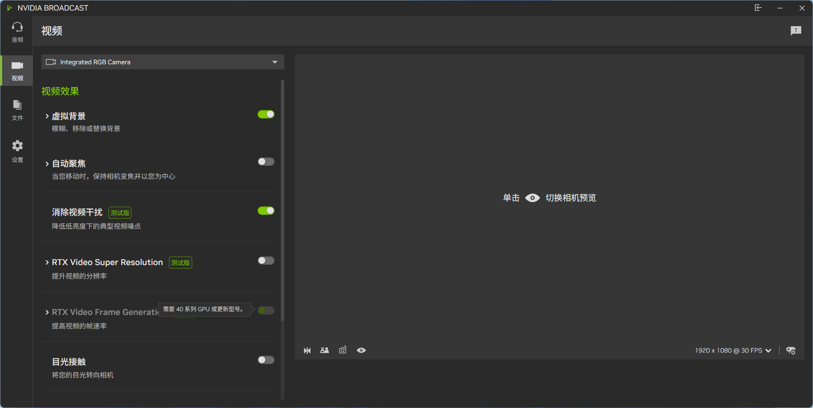
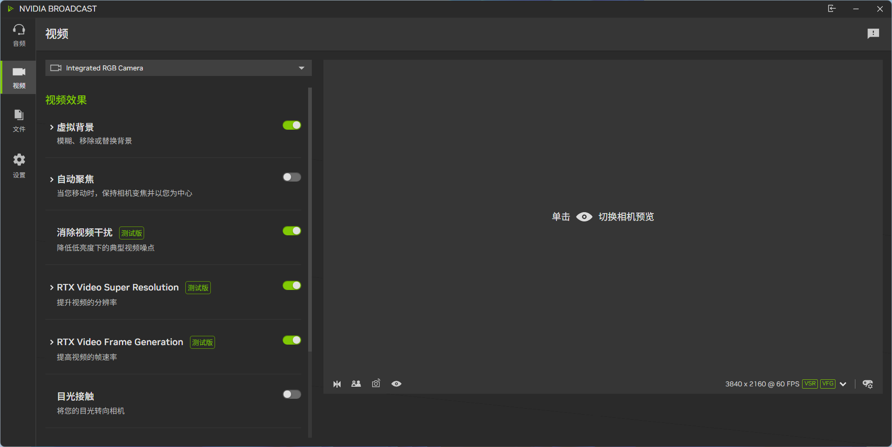
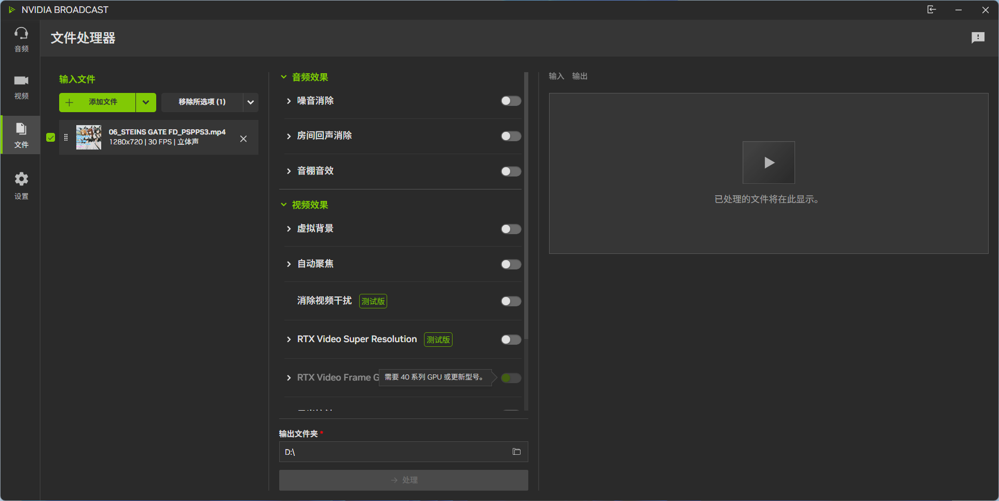
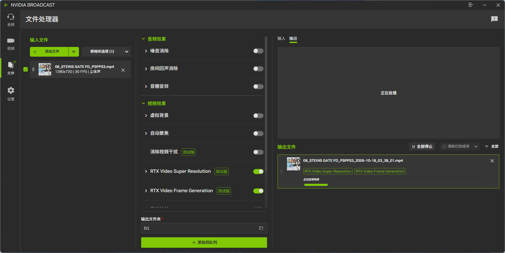

# NVIDIA Broadcast Video Frame Generation Patch (RTX 30 Series)

[中文](README.md) · **English**

Unlocks and enables the "Video Frame Generation" feature in NVIDIA Broadcast on NVIDIA GeForce RTX 30 Series (Ampere / SM86) GPUs.

A standalone proxy DLL (`version.dll`) weighing only ~11 KB. Zero external dependencies, leaving all original system files unmodified.

## Requirements

- **OS**: Windows 11 64-bit
- **GPU**: NVIDIA GeForce RTX 30 Series (RTX 3050, 3060, 3070, 3080, 3090, etc.)
- **Software**: Latest official NVIDIA Broadcast installed (with camera effects components)
- **Driver**: NVIDIA Driver 617.42 or newer

## Installation & Usage

1. **Exit Application**: Close NVIDIA Broadcast from the system tray (if a file-in-use error occurs, terminate the process in Task Manager).
2. **Copy Proxy DLL**: Download `version.dll` from the Releases page and copy it directly to the application installation directory:
   C:\Program Files\NVIDIA Corporation\NVIDIA Broadcast\
   *(Note: There is no existing file with this name by default. Simply paste it there; no files need to be replaced.)*
3. **Enable Feature**: Launch NVIDIA Broadcast and navigate to the "Camera" settings. The "Video Frame Generation" toggle is now unlocked—turn it on to output smooth 60 FPS video.
4. **Uninstall**: Exit the application and delete `version.dll` from the directory to revert to the default state.

## Screenshots & Comparison

| Before Patch (Restricted) | After Patch (Unlocked 60 FPS) |
| :---: | :---: |
|  |  |
|  |  |

## FAQ / Troubleshooting

- **Toggle is still grayed out**: Ensure your GPU driver is updated to 617.42+, and verify that `version.dll` is placed in the installation root directory (alongside `NVIDIA Broadcast.exe`).
- **File in use / Access denied**: Terminate all NVIDIA Broadcast background processes in Task Manager before copying.

## License

This project is licensed under the [MIT License](LICENSE).